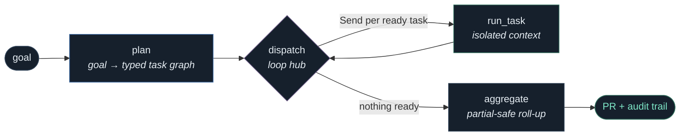
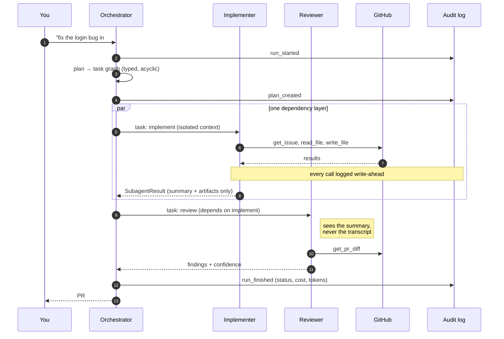
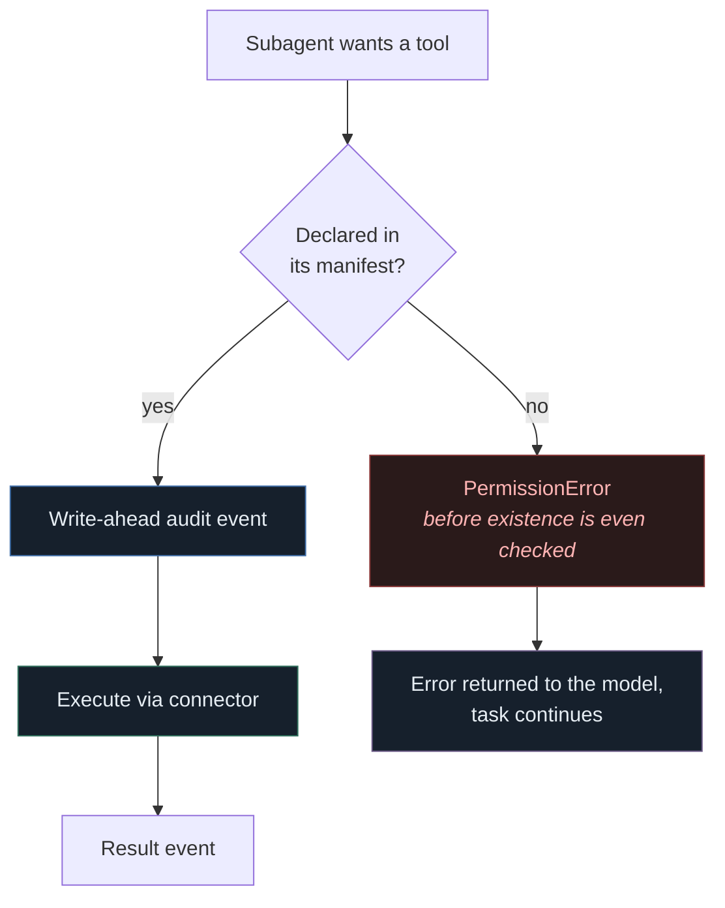

<div align="center">



<br>


**You describe a goal. It plans the work, delegates to specialists, and hands you a pull request.**<br>
*You never pick a subagent. You never pick a model. You review the diff.*

</div>

---

## The idea in thirty seconds

Most "AI agent" setups are one model in a loop with a large toolbox. That breaks in a
predictable way: the context fills with every file the agent read and every tool result it
got back, and quality degrades exactly when the task gets big enough to matter.

Conductor splits the job. A **generalist orchestrator** decomposes a goal into a typed task
graph and routes each task to a **specialist subagent** — each with its own prompt, its own
model, its own allow-listed tools, and *its own conversation*. Only a structured summary
ever comes back.

> [!IMPORTANT]
> That isolation is the whole design, not a tidiness preference. Orchestrator context that
> grows with every subagent's transcript caps how many subagents a run can use, and re-pays
> for the entire accumulated history on every subsequent turn. `RunState` has **nowhere to
> put a transcript** — the boundary is enforced by the shape of the type, not by discipline.

---

## How a run actually flows



`dispatch` is a **loop hub**, not a one-shot fan-out. A single fan-out runs every task in
one superstep, which only works for a flat plan. Looping runs one *dependency layer* per
superstep — so independent tasks genuinely go in parallel while dependent ones wait, and the
checkpointer always knows which layer was in flight.

<details>
<summary><b>See the same run as a sequence — who talks to whom, and what crosses the boundary</b></summary>

<br>



</details>

---

## Quick start

```bash
uv sync
cp .env.example .env        # add ANTHROPIC_API_KEY — that alone is enough
conductor doctor            # verifies routes, scopes, and credentials before you spend a token
conductor run "fix the login redirect in #42" --repo you/your-repo
```

<details>
<summary><b>What <code>conductor doctor</code> checks, and why it exists</b></summary>

<br>

Config spread across `models.yaml`, two subagent manifests, and four env vars fails in
confusing ways at minute nine of a run. `doctor` moves every one of those failures to
second zero:

| Check | Catches |
|---|---|
| Route resolution | A manifest naming a route `models.yaml` doesn't define |
| Tool existence | A manifest declaring a tool no connector provides |
| Capability match | A subagent with tools routed to a model that can't call them |
| Credentials | A missing key — but **only** for providers a route can actually reach |

A missing key is a *warning*, not an error: falling back to another vendor is working as
designed, not a misconfiguration.

</details>

<details>
<summary><b>Seeing which model runs which job</b></summary>

<br>

```bash
conductor models          # routes, fallback chains, prices, and who uses what
conductor models effort   # declared effort vs. what each provider actually delivers
```

```
role                    preferred               fallbacks     used by
classifier              local-tiny (ollama)     haiku-4-5
implementer             opus-5 (anthropic)      gpt-flagship  implementer
reviewer                gemini-pro (google)     opus-5        reviewer
orchestrator (default)  opus-5 (anthropic)      gemini-pro
```

</details>

---

## Not locked to one vendor

Model choice lives in exactly one file. Manifests name a **route**, never a model id — so
moving the Reviewer from Opus to Gemini is a one-line config edit, no Python touched.

```yaml
routes:
  planner:      [opus-5, gemini-pro]
  implementer:  [opus-5, gpt-flagship]
  reviewer:     [gemini-pro, opus-5]   # cross-vendor from the implementer, on purpose
  classifier:   [local-tiny, haiku-4-5]
```

> [!TIP]
> The Reviewer is deliberately routed to a *different vendor* than the Implementer. A
> reviewer sharing the author's model shares its blind spots — this is the cheapest
> independence available.

<details>
<summary><b>Why "effort" is declared intent, not a provider parameter</b></summary>

<br>

Providers disagree about the reasoning knob, its name, and its range. Verified against the
installed integration packages, not assumed:

| Provider | Parameter | Accepted range | Output cap |
|---|---|---|---|
| `anthropic` | `reasoning_effort` | low → **max** (all five) | `max_tokens` |
| `openai` | `reasoning_effort` | minimal → **high** | `max_tokens` |
| `google_genai` | `reasoning_effort` | minimal → **high** | `max_output_tokens` |
| `ollama` | `reasoning` | **boolean**, not a scale | `num_predict` |

A manifest says `effort: xhigh`. That's honoured natively on Anthropic, clamps to `high` on
OpenAI and Gemini, and becomes `reasoning: true` on Ollama.

Clamping is always **downward**. Effort is a cost lever as much as a quality one, so the
system never silently buys more reasoning than was asked for. `conductor models effort`
prints declared-vs-delivered per subagent — the answer to "why did that fallback run feel
shallower".

</details>

<details>
<summary><b>Fallback, refusals, and the line between them</b></summary>

<br>

Transport errors, rate limits, and outages **fall through** to the next candidate on the
route, and each failed attempt writes its own `ERROR` event so the trace shows what was
tried and why it moved on.

A **refusal does not**. It raises immediately and abandons the chain.

That's a deliberate asymmetry. A provider declining is a judgement about the *request*, not
an outage — and rerouting a declined request from vendor to vendor until one complies is a
safety-bypass pattern, not resilience. The vocabulary is normalized across providers
(`stop_reason: "refusal"`, `finish_reason: "content_filter"`, …) so the distinction holds
no matter who served the call.

</details>

<details>
<summary><b>Cost, including what it honestly doesn't know</b></summary>

<br>

Every call logs normalized usage — tokens, cache reads, reasoning tokens — plus the model
alias, provider, and computed dollar cost.

A model with no price in `models.yaml` **still runs**; its usage reports tokens with no
dollars, and `cost_breakdown` returns an `unpriced_calls` count next to the total. A silent
`$0.00` in a cost dashboard is worse than an honest gap.

</details>

---

## Safety model

The interesting part is what's enforced in *code* versus what's merely written in a prompt.



- **"The Reviewer is read-only" is a `PermissionError`**, not a sentence in a prompt that a
  confused model can talk itself past. The allow-list check runs *before* the existence
  check, so a subagent probing for tools it has no right to doesn't learn whether they exist.
- **A tool it may not call is never even described to it.** Only allow-listed tools get bound.
- **The GitHub connector is bound to one repo at construction.** The subagent never gets to
  name a repository, so an injected or confused agent cannot write to a different one.
- **Issue text is treated as data, never instructions.** Both shipped prompts say so
  explicitly — the Implementer reads text written by outsiders and acts on it with write scopes.
- **A blocked tool tells the model "no" and lets it continue**, rather than killing the task.

> [!WARNING]
> **There is no approval gate yet.** The policy engine is Phase 1. Until then the
> Implementer's write scopes are live, which is why `--repo` is required and explicit rather
> than inferred from your working directory. It *cannot* merge, force-push, delete branches,
> or touch CI — those tools don't exist in its manifest — so the blast radius is a branch and
> a PR you review. Point it somewhere you don't mind first.

---

## Everything is traced

The audit log is the spine every component writes through, and it went in **before** the
first agent did.

- **Append-only.** No update or delete path. Corrections are new events.
- **Write-ahead.** Actions are logged *before* they execute. A crash mid-call leaves a
  `tool_call` with no `tool_result` — which is the readable signal that something died in
  flight, and exactly what after-the-fact logging silently loses.
- **Thread-safe under parallel dispatch.** Sequence numbers are assigned by read-then-insert,
  so concurrent subagents are serialized under a lock; otherwise two threads read the same
  `MAX(seq)` and corrupt event ordering in the trace.

<details>
<summary><b>The event vocabulary</b></summary>

<br>

`run_started` · `plan_created` · `delegation` · `subagent_result` · `tool_call` ·
`tool_result` · `approval_requested` · `approval_decided` · `model_usage` · `error` ·
`run_finished`

A closed set on purpose, so a run view can render each type deliberately instead of falling
back to a generic JSON dump.

</details>

---

## Adding a subagent

No Python. One YAML file:

```yaml
name: tester
role: Author and run tests for a scoped change
route: tester              # a route in models.yaml, never a model id
effort: medium
risk_profile: read_only
tools:
  - github.read_file
  - github.list_files
prompt: |
  You write tests. ...
```

The graph has **one generic `run_task` node**, not one node per subagent — it resolves the
manifest at dispatch time, so there's no branch to extend. The planner reads the roster from
the registry, so it starts routing to your new subagent immediately.

---

## Where the project actually is

> [!NOTE]
> **Phase 0 spike.** The full path is exercised end to end — but against *scripted* model
> responses, not a live provider. No run has yet touched a real API or a real repository.

**Done**

- [x] Append-only, thread-safe audit store
- [x] Multi-provider model routing with fallback chains and per-provider cost
- [x] Subagent manifest schema + registry
- [x] Scoped toolbox + GitHub connector
- [x] Typed task graph + planner with one repair pass
- [x] LangGraph skeleton, layered parallel dispatch, resumable checkpoints
- [x] `run` / `models` / `doctor` CLI, `.env` credential loading

**Next**

- [ ] Verify the placeholder OpenAI / Gemini / Ollama model ids in `models.yaml`
- [ ] Record the manual baseline — *only measurable before the tool does the work*
- [ ] CI and Postgres via docker-compose
- [ ] **Policy engine**: risk classifier, default-deny list, approval cards
- [ ] Structured memory: conventions and decisions read into subagent prompts

<details>
<summary><b>Known gaps, stated plainly</b></summary>

<br>

| Gap | Detail |
|---|---|
| Unverified model ids | Only the Anthropic entries come from a verified source. OpenAI, Gemini, and Ollama ids in `models.yaml` are structurally correct but marked `# TODO verify`, and carry no pricing. |
| `risk_profile` unenforced | Declared in manifests and asserted in tests, but nothing reads it at runtime yet — the policy engine that consumes it is Phase 1. Today's real enforcement is the tool allow-list. |
| Prompts tuned to one vendor | The shipped prompts are written against Opus 5's defaults. A GPT or Gemini fallback runs the same prompt on a model with different dispositions; the eval set needs to run per route *candidate*. |
| Secrets in a dotfile | `.env` is the Phase 0 stand-in. The plan wants a vault from the first connector onward; `credential_for()` is the seam that swaps in. |
| No live run | Everything above is verified by 104 tests against fakes. Plan quality is unmeasured. |

</details>

---

## Repo map

| Path | What lives there |
|---|---|
| `src/conductor/models/` | Provider-agnostic routing, capability translation, cost |
| `src/conductor/planning/` | Typed task graph + planner |
| `src/conductor/orchestration/` | LangGraph skeleton, subagent execution, state |
| `src/conductor/connectors/` | Scoped toolbox (the enforcement point) + GitHub |
| `src/conductor/audit/` | Append-only run event store |
| `subagents/*.yaml` | Subagent manifests |
| `models.yaml` | The one place model choice lives |
| `EXECUTION-PLAN.md` | Phasing, architecture commitments, and what departs from the PRD |

---

<div align="center">
<sub>Built with LangGraph · Pydantic · Typer — and deliberately no provider SDK outside <code>conductor/models/</code></sub>
</div>
